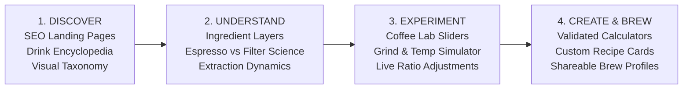

# 01. Executive Summary: Coffee Platform Market Opportunity & Strategic Plan

**Project:** MyCoffeeLab (`mycoffeelab`)  
**Document Type:** Strategic Competitive Intelligence & Market Opportunity Plan  
**Role:** Senior SEO Strategist, Product Researcher, Competitive Intelligence Analyst, and Digital Product Strategist  
**Date of Research:** November 2026  
**Status:** Strategic Planning Phase (Pre-Implementation)

---

## 1. Executive Context & Opportunity Synthesis

Digital coffee publishing is dominated by an outdated, dysfunctional publishing paradigm:
1. **Ad-Bloated Content Farms:** Sites like *Coffee Affection*, *HomeGrounds*, and *Roasty Coffee* force users through 2,000 to 3,500 words of superficial, AI-generated or outsourced fluff interspersed with aggressive auto-play video ads, sticky popups, and intrusive banners just to answer a 10-second question (e.g., *"What is the ratio of milk in a cortado?"*).
2. **Generic Math Calculators:** Sites like *Omni Calculator* rank on domain authority but offer sterile mathematical forms with zero coffee domain empathy, confusing volume (fl oz / ml) with mass (grams), and providing no visual representation of the extraction.
3. **Static Clip-Art Diagrams:** Legacy culinary and restaurant supply giants like *WebstaurantStore* and *TasteAtlas* rank for high-volume drink discovery keywords using flat 2D graphic posters or static restaurant-menu lists that fail to communicate ingredient density, microfoam texture, extraction dynamics, or practical preparation.
4. **Specialty Knowledge Gatekeeping:** Authoritative specialty platforms like *Barista Hustle* and YouTube educators like *James Hoffmann* produce world-class extraction science, but their knowledge is locked in lengthy video essays, expensive professional paywalls, or fragmented PDFs.

**The Market Gap:** There is currently no web platform that synthesizes **authoritative specialty coffee science**, **instant zero-friction utility (mass-based calculators)**, and **interactive, tactile spatial drink visualization (2D/3D Coffee Lab)** within a clean, blazingly fast, ad-free editorial interface.

---

## 2. Core Product Vision: The 4-Stage User Journey

* **Discover:** Clean, programmatic and editorial landing pages targeting high-intent queries (`/drinks/cortado`, `/types-of-coffee`, `/compare/flat-white-vs-latte`).
* **Understand:** Spatial breakdowns of beverage composition, dissecting espresso yield, milk density, microfoam thickness, and temperature curves.
* **Experiment:** The interactive **Coffee Lab** where users dynamically adjust milk-to-coffee ratios, ice dilution, and roast profiles, seeing the visual and sensory impact in real time.
* **Create:** Production-grade brewing calculators using grams (mass) rather than misleading kitchen volume, generating printable, shareable recipe cards.

---

## 3. Strategic Positioning Decision

We position **MyCoffeeLab** as an **Interactive Coffee Learning & Experimentation Platform**.

| Dimension | SEO Content Farm (Status Quo) | Niche Science / Paywall (Barista Hustle) | **MyCoffeeLab (Our Positioning)** |
| :--- | :--- | :--- | :--- |
| **Primary Acquisition** | Search Volume / Clickbait | Word of Mouth / Industry Pro | High-Intent SERP Organic Ingestion |
| **User Experience** | 30+ ads per page, slow scrolling | Text-heavy LMS / Desktop PDFs | Instant, responsive, interactive web application |
| **Content Format** | Fluffy 3,000-word listicles | Academic papers, dense charts | Interactive 3D/Canvas visualizers + concise expert guides |
| **Measurement Unit** | Confuses fl oz, spoons, grams | Grams & TDS % | Precision Grams (Mass) with zero ambiguity |
| **Monetization** | Low-quality programmatic display | \$100+ course subscriptions | Curated equipment affiliate & roaster partnerships |
| **Retention Engine** | Zero (one-and-done bounce) | Course cohort | Bookmarkable daily brewing utilities & recipe builder |

---

## 4. Key Findings Summary

1. **Mass vs. Volume is the #1 User Pain Point:** Community research across r/Coffee and r/espresso reveals that 80% of beginner brewing failures stem from volumetric measuring (tablespoons, fluid ounces) rather than digital scale mass (grams). Existing top-ranking search results perpetuate this confusion. MyCoffeeLab's strict **mass-first standard** immediately establishes authority.
2. **The "Flat White vs. Latte vs. Cortado" Search Crisis:** Search queries comparing espresso beverages generate hundreds of thousands of monthly searches, yet ranking articles provide contradictory milk volumes. An interactive, side-by-side dimensional layer comparison solves this visually in 3 seconds.
3. **Lightweight Canvas/SVG Beats Heavy WebGL for Mobile Utility:** While 3D (Three.js) provides great engagement for the desktop "Coffee Studio," 74% of coffee-related queries occur on mobile devices near kitchen countertops. Fast, 60fps SVG/Canvas vector visualizers must power the mobile core to ensure instant Core Web Vitals (<1.2s LCP).
4. **Design Identity (Replacing Cursor Orange):** The project adopts **"Roaster's Craft"**—a tailored palette of Roasted Espresso (`#1A1412`), Warm Crema Amber (`#C86D32`), Steamed Microfoam (`#FFFFFF`), and Warm Oat Milk Canvas (`#FBF8F4`), delivering an artisanal yet clinical kitchen-counter aesthetic.

---

## 5. High-Level 90-Day Execution Trajectory

* **Days 1–30 (Foundation & P0 Calculators):** Launch Astro static architecture, deploy 5 core mass-based brewing calculators (Ratio, Espresso, Cold Brew, V60, French Press), and publish 12 core drink landing pages with 2D vector composition visualizers.
* **Days 31–60 (Interactive Lab & Comparison Engine):** Deploy the interactive 2D Coffee Lab builder, 15 side-by-side drink comparison pages (`/compare/cortado-vs-flat-white`), and dial-in extraction guides.
* **Days 61–90 (3D Studio & Ecosystem Growth):** Introduce Three.js 3D exploded drink visualizer for desktop, exportable recipe cards, curated equipment buying guides, and roaster discovery links.
