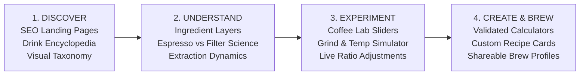

# 01. Executive Summary: Coffee Platform Market Opportunity & Strategic Plan

**Project:** MyCoffeeLab (`mycoffeelab`)  
**Document Type:** Strategic Competitive Intelligence & Market Opportunity Plan  
**Role:** Senior SEO Strategist, Product Researcher, Competitive Intelligence Analyst, and Digital Product Strategist  
**Date of Research:** November 2026  
**Status:** Strategic Planning Phase (Pre-Implementation)  
**Scope lock:** [17-BUILD-SPECIFICATION.md](./17-BUILD-SPECIFICATION.md) wins where this summary disagrees with it.

---

## 1. Executive Context & Opportunity Synthesis

Digital coffee publishing is dominated by an outdated, dysfunctional publishing paradigm:
1. **Ad-Bloated Content Farms:** Sites like *Coffee Affection*, *HomeGrounds*, and *Roasty Coffee* force users through 2,000 to 3,500 words of superficial, AI-generated or outsourced fluff interspersed with aggressive auto-play video ads, sticky popups, and intrusive banners just to answer a 10-second question (e.g., *"What is the ratio of milk in a cortado?"*).
2. **Generic Math Calculators:** Sites like *Omni Calculator* rank on domain authority but offer sterile mathematical forms with zero coffee domain empathy, confusing volume (fl oz / ml) with mass (grams), and providing no visual representation of the extraction.
3. **Static Clip-Art Diagrams:** Legacy culinary and restaurant supply giants like *WebstaurantStore* and *TasteAtlas* rank for high-volume drink discovery keywords using flat 2D graphic posters or static restaurant-menu lists that fail to communicate ingredient density, microfoam texture, extraction dynamics, or practical preparation.
4. **Specialty Knowledge Gatekeeping:** Authoritative specialty platforms like *Barista Hustle* and YouTube educators like *James Hoffmann* produce world-class extraction science, but their knowledge is locked in lengthy video essays, expensive professional paywalls, or fragmented PDFs.

**The Market Gap:** There is currently no web platform that synthesizes **authoritative specialty coffee science**, **instant zero-friction utility (mass-based calculators)**, and **interactive, tactile spatial drink visualization (2D/3D Coffee Lab)** within a clean, blazingly fast, ad-free editorial interface.

---

## 2. Core Product Vision: The 4-Stage User Journey

* **Discover:** Clean, programmatic and editorial landing pages targeting high-intent queries (`/drinks/cortado`, `/types-of-coffee`, `/compare/flat-white-vs-latte`).
* **Understand:** Spatial breakdowns of beverage composition, dissecting espresso yield, milk density, microfoam thickness, and temperature curves.
* **Experiment:** The interactive **Coffee Lab** where users dynamically adjust milk-to-coffee ratios, ice dilution, and roast profiles, seeing the visual and sensory impact in real time.
* **Create:** Production-grade brewing calculators using grams (mass) rather than misleading kitchen volume, generating printable, shareable recipe cards.

---

## 3. Strategic Positioning Decision

We position **MyCoffeeLab** as an **Interactive Coffee Learning & Experimentation Platform**.

| Dimension | SEO Content Farm (Status Quo) | Niche Science / Paywall (Barista Hustle) | **MyCoffeeLab (Our Positioning)** |
| :--- | :--- | :--- | :--- |
| **Primary Acquisition** | Search Volume / Clickbait | Word of Mouth / Industry Pro | High-Intent SERP Organic Ingestion |
| **User Experience** | 30+ ads per page, slow scrolling | Text-heavy LMS / Desktop PDFs | Instant, responsive, interactive web application |
| **Content Format** | Fluffy 3,000-word listicles | Academic papers, dense charts | Interactive 3D/Canvas visualizers + concise expert guides |
| **Measurement Unit** | Confuses fl oz, spoons, grams | Grams & TDS % | Precision Grams (Mass) with zero ambiguity |
| **Monetization** | Low-quality programmatic display | \$100+ course subscriptions | Curated equipment affiliate & roaster partnerships |
| **Retention Engine** | Zero (one-and-done bounce) | Course cohort | Bookmarkable daily brewing utilities & recipe builder |

---

## 4. Key Findings Summary

These are planning judgments. They are not measured search volumes. Document 02 is still empty, and document 17 defines the numbers the site is allowed to print.

1. **Recipes in grams.** Ranking pages often tell people to use tablespoons or fluid ounces. The launch calculators take coffee, water, dose, and yield in grams. Cup size may show millilitres and fl oz because that is how the empty vessel is sold.
2. **The drink pairs people confuse.** Flat white, latte, cortado, cappuccino, macchiato, and americano are the comparison set. Volumes for those drinks are house defaults with regional notes, not a single official recipe. The keyword export is still pending, so this is not a traffic claim.
3. **SVG for the launch cup.** Three.js stays out of P0. Mobile share is an assumption above 70 percent, not a measured 74 percent. Performance budgets are in document 17.
4. **Design identity.** This project uses "Roaster's Craft": ink `#1A1412`, canvas `#FBF8F4`, button `#9A4316`. Crema `#C86D32` is a large mark and a drink layer. It is not the button color.

---

## 5. High-Level 90-Day Execution Trajectory

The week-by-week list and the pass conditions live in document 17. In short:

* **Days 1–30:** The 25 P0 URLs. Three calculators, 11 drink pages, five comparisons. V60 and French press are presets on the ratio calculator, not their own URLs. Doppio is a section of the espresso page.
* **Days 31–60:** Paste the keyword export into document 02, or record that it is still missing. Fix recipe and contrast defects before adding pages.
* **Days 61–90:** Review Search Console for the calculators and comparisons. The Lab, the dial-in compass, Three.js, and affiliate links are not in this window unless that review and the keyword export both support a P1 page.
