# 09. SEO Topic Cluster and URL Architecture

**Architecture Philosophy:** Hub-and-spoke URLs, one intent per URL.  
**Launch set:** The P0 list in [17-BUILD-SPECIFICATION.md](./17-BUILD-SPECIFICATION.md) is the set that gets built. The diagram below includes later URLs; they are marked in the notes under it.

---

## 1. Topic Cluster Mapping & Pillar Hierarchy

```mermaid
graph TD
    Home["Homepage / Core Hub\n(/)"] --> C1["Cluster 1: Drink Taxonomy\nPillar: /types-of-coffee/"]
    Home --> C2["Cluster 2: Calculators & Tools\nPillar: /calculators/"]
    Home --> C3["Cluster 3: Drink Comparisons\nPillar: /compare/"]
    Home --> C4["Cluster 4: Brewing & Science\nPillar: /science/"]
    Home --> Lab["The Coffee Lab Builder\n(/lab/)"]

    C1 --> D1["/drinks/espresso/"]
    C1 --> D2["/drinks/latte/"]
    C1 --> D3["/drinks/cappuccino/"]
    C1 --> D4["/drinks/flat-white/"]
    C1 --> D5["/drinks/cortado/"]
    C1 --> D6["/drinks/macchiato/"]
    C1 --> D7["/drinks/americano/"]
    C1 --> D8["/drinks/cold-brew/"]

    C2 --> T1["/calculators/coffee-to-water-ratio/"]
    C2 --> T2["/calculators/espresso-ratio/"]
    C2 --> T3["/calculators/cold-brew-ratio/"]
    C3 --> Comp1["/compare/flat-white-vs-latte/"]
    C3 --> Comp2["/compare/cortado-vs-flat-white/"]
    C3 --> Comp3["/compare/macchiato-vs-cortado/"]
    C3 --> Comp4["/compare/cappuccino-vs-latte/"]
    C3 --> Comp5["/compare/espresso-vs-americano/"]

    C4 --> S1["/science/grind-size-chart/"]
    C4 --> S2["/science/espresso-dial-in/"]
    C4 --> S3["/science/extraction-guide/"]
    C4 --> S4["/science/water-temperature/"]
```

`/science/`, `/lab/`, and the four science spokes are later URLs. P0 does not build them. V60 and French press are presets on the ratio calculator, not spokes. Drink pages missing from the diagram and still in P0: ristretto, lungo, and mocha. Doppio is an H2 on `/drinks/espresso/`, not a URL.

---

## 2. Granular URL Specification & Page-Type Matrix

| Target URL | Primary Keyword Entity | Page Classification | Intent Alignment | Page Layout & Component Requirements |
| :--- | :--- | :--- | :--- | :--- |
| `/` | *coffee to water ratio calculator* | Tool first screen | Tool | The coffee-to-water calculator, then links to drinks and comparisons. |
| `/types-of-coffee/` | *coffee drinks in grams* | Directory of the 11 P0 drinks | Informational / Directory | Links only. Not a bid for the head term "types of coffee." |
| `/drinks/[drink-slug]/` | *[drink name] recipe, [drink name] ratio* | **Cluster Supporting Page** | **Hybrid (Educational + Interactive)** | Dynamic SVG/Canvas cup cross-section, mass recipe breakdown, taste notes, step-by-step brew card. |
| `/drinks/flat-white/` | *what is a flat white, flat white recipe* | Cluster Supporting Page | Hybrid | 180 ml cup. House recipe in document 17. Foam centimetres are computed, not typed in as a second source of truth. |
| `/drinks/cortado/` | *cortado coffee, cortado ratio* | Cluster Supporting Page | Hybrid | Gibraltar house default from document 17. Spain variant is copy, not the first drawing. |
| `/drinks/macchiato/` | *espresso macchiato, traditional macchiato* | Cluster Supporting Page | Hybrid | Demitasse cup cross-section, stained foam vs Starbucks syrup disambiguation alert banner. |
| `/calculators/` | *coffee calculators, brewing tools* | **Pillar 2 (Utilities Hub)** | Tool Directory | Quick-selector card grid for all brewing calculators. |
| `/calculators/coffee-to-water-ratio/` | *coffee to water ratio calculator* | **Pure Interactive Tool** | **Tool / Utility** | Grams in, grams out. SCA center is the default. Shop ratios are labeled as shop ratios. Tests are in document 17. |
| `/calculators/espresso-ratio/` | *espresso ratio calculator, espresso yield* | **Pure Interactive Tool** | **Tool / Utility** | Dose 7–22 g so a traditional single fits. Default 18 g at 1:2 = 36 g. Time is a sentence, not a calculated law. |
| `/calculators/cold-brew-ratio/` | *cold brew ratio calculator* | **Pure Interactive Tool** | **Tool / Utility** | Concentrate default 1:5. Ready-to-drink default 1:12. Grounds retention is an assumption, default 2 g water per 1 g coffee. |
| `/compare/` | *coffee comparisons* | Directory of the five P0 comparisons | Directory / Informational | Five static links. A generate-any-pair tool is not in P0. |
| `/compare/flat-white-vs-latte/` | *flat white vs latte, difference between...* | **Visual Comparison Engine** | Comparison / Informational | Synchronized dual-glass visualizer, side-by-side metric table (cup size, milk volume, microfoam, strength). |
| `/compare/cortado-vs-flat-white/` | *cortado vs flat white* | Visual Comparison Engine | Comparison / Informational | Gibraltar cortado beside the 180 ml flat white, same millilitres-per-pixel scale. |
| `/lab/` | *coffee builder, interactive coffee lab* | Later. Not in P0. | Interactive / Experimental | If built, use the query shape in document 17. No caffeine or calorie total until a sourced range exists. |
| `/science/` | *coffee science, extraction science* | Later. Not in P0. | Educational Hub | Do not publish this hub until a spoke from document 17's P1 list is actually built. |
| `/science/grind-size-chart/` | *coffee grind size chart, grind settings* | Later. Not in P0. | Visual / Informational | Build only after the keyword row is filled. |
| `/science/espresso-dial-in/` | *how to dial in espresso, espresso troubleshooting* | Later. Not in P0. | Problem-Solving | Words carry sour, balanced, and bitter. Do not ship a single "exact grind click" as if it were measured. |

---

## 3. Strict Cannibalization Safeguards

To prevent competing against our own pages in Google SERPs:
1. **Directory vs. drink page:** `/types-of-coffee/` lists the 11 drinks and does not carry a full recipe. Each drink page carries one recipe. The directory does not target "types of coffee" as a head term.
2. **Comparison URL Canonicalization:** Never create inverse URLs. `/compare/flat-white-vs-latte/` is canonical. An incoming request for `/compare/latte-vs-flat-white/` permanently 301-redirects to `/compare/flat-white-vs-latte/`.
3. **Tool vs. Article Clean Boundary:** Do not publish separate blog articles titled *"How to calculate coffee ratios"* if `/calculators/coffee-to-water-ratio/` already exists. The calculation tool itself serves as the definitive URL, containing all necessary explanatory copy beneath the interactive tool.

---

## 4. Internal Linking & Crawl Graph Architecture

* **Upward Breadcrumbs:** Every cluster page explicitly breadcrumbs to its parent pillar (`Home > Drinks > Cortado` or `Home > Calculators > Espresso Ratio`).
* **Lateral Contextual Bridges:**
  * When a user views `/drinks/cortado/`, contextual chips link directly to `/compare/cortado-vs-flat-white/` and `/compare/macchiato-vs-cortado/`.
  * From any espresso-based drink page, a direct utility link points to `/calculators/espresso-ratio/` with pre-filled default parameters.
* **Anchor Text Precision:** Use descriptive, exact-match and partial-match anchor text (e.g., *"use our espresso yield calculator"* instead of *"click here"*).

---

## 5. Exploiting Competitor Topical Gaps

Our competitive audit revealed three massive blind spots among ranking sites:
1. **The Modern Specialty Menu Gap:** Most competitor listicles still describe commercial 1990s Italian menus (e.g., classifying a Macchiato as an 8-layer caramel syrup drink, or missing modern standards like the Piccolo Latte or Freddo Espresso). MyCoffeeLab addresses modern third-wave coffee standards while clearly delineating commercial vs specialty definitions.
2. **The "Why Is My Drink Bad?" Gap:** Competitors describe how drinks *should* taste, but offer zero interactive guidance when something goes wrong. Our `/science/espresso-dial-in/` tool directly addresses the huge volume of troubleshooting queries.
3. **Mass-Based Recipe Standards:** Competitors force users to calculate ounces into grams. By making grams the primary unit with instant metric/imperial toggle, we serve both international users and precision home baristas cleanly.
