# 09. SEO Topic Cluster and URL Architecture

**Architecture Philosophy:** Hub-and-Spoke Pillar Model optimized for semantic topical authority, zero keyword cannibalization, and precise search intent alignment.

---

## 1. Topic Cluster Mapping & Pillar Hierarchy

```mermaid
graph TD
    Home["Homepage / Core Hub\n(/)"] --> C1["Cluster 1: Drink Taxonomy\nPillar: /types-of-coffee/"]
    Home --> C2["Cluster 2: Calculators & Tools\nPillar: /calculators/"]
    Home --> C3["Cluster 3: Drink Comparisons\nPillar: /compare/"]
    Home --> C4["Cluster 4: Brewing & Science\nPillar: /science/"]
    Home --> Lab["The Coffee Lab Builder\n(/lab/)"]

    C1 --> D1["/drinks/espresso/"]
    C1 --> D2["/drinks/latte/"]
    C1 --> D3["/drinks/cappuccino/"]
    C1 --> D4["/drinks/flat-white/"]
    C1 --> D5["/drinks/cortado/"]
    C1 --> D6["/drinks/macchiato/"]
    C1 --> D7["/drinks/americano/"]
    C1 --> D8["/drinks/cold-brew/"]

    C2 --> T1["/calculators/coffee-to-water-ratio/"]
    C2 --> T2["/calculators/espresso-ratio/"]
    C2 --> T3["/calculators/cold-brew-ratio/"]
    C2 --> T4["/calculators/v60-calculator/"]
    C2 --> T5["/calculators/french-press-ratio/"]

    C3 --> Comp1["/compare/flat-white-vs-latte/"]
    C3 --> Comp2["/compare/cortado-vs-flat-white/"]
    C3 --> Comp3["/compare/macchiato-vs-cortado/"]
    C3 --> Comp4["/compare/cappuccino-vs-latte/"]
    C3 --> Comp5["/compare/espresso-vs-ristretto/"]

    C4 --> S1["/science/grind-size-chart/"]
    C4 --> S2["/science/espresso-dial-in/"]
    C4 --> S3["/science/extraction-guide/"]
    C4 --> S4["/science/water-temperature/"]
```

---

## 2. Granular URL Specification & Page-Type Matrix

| Target URL | Primary Keyword Entity | Page Classification | Intent Alignment | Page Layout & Component Requirements |
| :--- | :--- | :--- | :--- | :--- |
| `/` | *coffee learning platform, coffee lab* | Brand Hub / App Portal | Navigational / Discovery | Hero interactive glass visualizer, quick calculator widget, drink grid, trending comparisons. |
| `/types-of-coffee/` | *types of coffee, coffee drinks guide* | **Pillar 1 (Taxonomy)** | Informational / Directory | Filterable visual grid of 24+ drinks, interactive cross-sections, classification by milk/caffeine. |
| `/drinks/[drink-slug]/` | *[drink name] recipe, [drink name] ratio* | **Cluster Supporting Page** | **Hybrid (Educational + Interactive)** | Dynamic SVG/Canvas cup cross-section, mass recipe breakdown, taste notes, step-by-step brew card. |
| `/drinks/flat-white/` | *what is a flat white, flat white recipe* | Cluster Supporting Page | Hybrid | 6 oz ceramic cup cross-section, microfoam slider (0.5cm), double ristretto vs espresso toggle. |
| `/drinks/cortado/` | *cortado coffee, cortado ratio* | Cluster Supporting Page | Hybrid | Gibraltar glass cross-section, 1:1 espresso to steamed milk ratio, historical Spain/Basque notes. |
| `/drinks/macchiato/` | *espresso macchiato, traditional macchiato* | Cluster Supporting Page | Hybrid | Demitasse cup cross-section, stained foam vs Starbucks syrup disambiguation alert banner. |
| `/calculators/` | *coffee calculators, brewing tools* | **Pillar 2 (Utilities Hub)** | Tool Directory | Quick-selector card grid for all brewing calculators. |
| `/calculators/coffee-to-water-ratio/` | *coffee to water ratio calculator* | **Pure Interactive Tool** | **Tool / Utility** | Multi-input reactive slider, grams/mass-first, visual liquid carafe fill, SCA standard toggles. |
| `/calculators/espresso-ratio/` | *espresso ratio calculator, espresso yield* | **Pure Interactive Tool** | **Tool / Utility** | Dose input (16–22g), ratio slider (1:1 to 1:3), yield output (g), time benchmark (25–30s). |
| `/calculators/cold-brew-ratio/` | *cold brew ratio calculator* | **Pure Interactive Tool** | **Tool / Utility** | Concentrate toggle (1:4 to 1:6) vs Ready-to-drink toggle (1:12 to 1:16), dilution ice calculator. |
| `/compare/` | *coffee comparisons, coffee drinks compared* | **Pillar 3 (Comparison Hub)**| Directory / Informational | Drink selector dropdowns ("Compare Drink A with Drink B") leading to dynamic comparison engine. |
| `/compare/flat-white-vs-latte/` | *flat white vs latte, difference between...* | **Visual Comparison Engine** | Comparison / Informational | Synchronized dual-glass visualizer, side-by-side metric table (cup size, milk volume, microfoam, strength). |
| `/compare/cortado-vs-flat-white/` | *cortado vs flat white* | Visual Comparison Engine | Comparison / Informational | 4 oz vs 6 oz vessel comparison, milk texture contrast, coffee intensity score. |
| `/lab/` | *coffee builder, interactive coffee lab* | **Core Web Application** | **Interactive / Experimental** | Full sandbox builder: Add shots, steam milk, aerate foam, add ice, syrups; live volume/caffeine meter. |
| `/science/` | *coffee science, extraction science* | **Pillar 4 (Science Hub)** | Educational Hub | Fundamentals of extraction, TDS, roast curves, solubility. |
| `/science/grind-size-chart/` | *coffee grind size chart, grind settings* | **Visual Science Tool** | Visual / Informational | Interactive particle visualizer with real-world comparisons (flour, table salt, sea salt, peppercorn). |
| `/science/espresso-dial-in/` | *how to dial in espresso, espresso troubleshooting* | **Interactive Diagnostic Tool**| Problem-Solving | "Sour vs Bitter" interactive compass; recommends yield and grind adjustments based on taste. |

---

## 3. Strict Cannibalization Safeguards

To prevent competing against our own pages in Google SERPs:
1. **Pillar vs. Cluster Segregation:** `/types-of-coffee/` targets broad taxonomy queries (*"all types of coffee"*). Individual drink pages (`/drinks/latte/`) target specific single-entity queries (*"latte recipe"*, *"how to make a latte"*). The pillar page links directly to each cluster page and never attempts to rank for single-drink recipes.
2. **Comparison URL Canonicalization:** Never create inverse URLs. `/compare/flat-white-vs-latte/` is canonical. An incoming request for `/compare/latte-vs-flat-white/` permanently 301-redirects to `/compare/flat-white-vs-latte/`.
3. **Tool vs. Article Clean Boundary:** Do not publish separate blog articles titled *"How to calculate coffee ratios"* if `/calculators/coffee-to-water-ratio/` already exists. The calculation tool itself serves as the definitive URL, containing all necessary explanatory copy beneath the interactive tool.

---

## 4. Internal Linking & Crawl Graph Architecture

* **Upward Breadcrumbs:** Every cluster page explicitly breadcrumbs to its parent pillar (`Home > Drinks > Cortado` or `Home > Calculators > Espresso Ratio`).
* **Lateral Contextual Bridges:**
  * When a user views `/drinks/cortado/`, contextual chips link directly to `/compare/cortado-vs-flat-white/` and `/compare/macchiato-vs-cortado/`.
  * From any espresso-based drink page, a direct utility link points to `/calculators/espresso-ratio/` with pre-filled default parameters.
* **Anchor Text Precision:** Use descriptive, exact-match and partial-match anchor text (e.g., *"use our espresso yield calculator"* instead of *"click here"*).

---

## 5. Exploiting Competitor Topical Gaps

Our competitive audit revealed three massive blind spots among ranking sites:
1. **The Modern Specialty Menu Gap:** Most competitor listicles still describe commercial 1990s Italian menus (e.g., classifying a Macchiato as an 8-layer caramel syrup drink, or missing modern standards like the Piccolo Latte or Freddo Espresso). MyCoffeeLab addresses modern third-wave coffee standards while clearly delineating commercial vs specialty definitions.
2. **The "Why Is My Drink Bad?" Gap:** Competitors describe how drinks *should* taste, but offer zero interactive guidance when something goes wrong. Our `/science/espresso-dial-in/` tool directly addresses the huge volume of troubleshooting queries.
3. **Mass-Based Recipe Standards:** Competitors force users to calculate ounces into grams. By making grams the primary unit with instant metric/imperial toggle, we serve both international users and precision home baristas cleanly.
