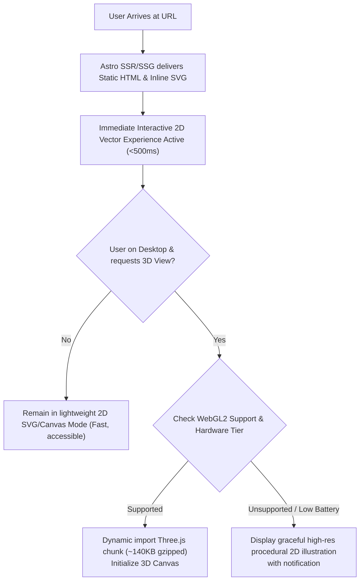

# 11. Technical and Experience Feasibility Assessment

**Core Engineering Principle:** Performance is a feature, a ranking factor, and a fundamental user right. A coffee tool used in a morning kitchen must load in under 1 second on a 4G mobile device.

---

## 1. Technical Stack Evaluation & Architecture

```
┌────────────────────────────────────────────────────────────────────────┐
│                     MYCOFFEELAB TECHNICAL STACK                        │
├───────────────────┬────────────────────────────────────────────────────┤
│ Framework         │ Astro 5.x (Content Collections, SSG, Islands Arch) │
├───────────────────┼────────────────────────────────────────────────────┤
│ Language          │ TypeScript (Strict mode, zero runtime 'any')       │
├───────────────────┼────────────────────────────────────────────────────┤
│ Styling & Motion  │ Modern CSS Custom Properties + Tailwind CSS v4     │
├───────────────────┼────────────────────────────────────────────────────┤
│ 2D Layer Engine   │ Native HTML5 SVG + Canvas API (Zero dependencies)  │
├───────────────────┼────────────────────────────────────────────────────┤
│ 3D Visualizer     │ Three.js (Lazy-loaded, dynamic import island)      │
├───────────────────┼────────────────────────────────────────────────────┤
│ State Management  │ Nanostores (Microscopic 1KB reactive store)        │
├───────────────────┼────────────────────────────────────────────────────┤
│ Deployment / CDN  │ Cloudflare Pages / Vercel Edge (Global sub-50ms)   │
└───────────────────┴────────────────────────────────────────────────────┘
```

---

## 2. 3D vs. 2D Architectural Decision: Where 3D Belongs and Where It Does Not

```
┌────────────────────────────────────────────────────────────────────────┐
│                    VISUAL ENGINE SELECTION MATRIX                      │
├──────────────────────────────────┬─────────────────────────────────────┤
│   USE 2D SVG / CSS (DEFAULT)     │     USE 3D THREE.JS (SELECTIVE)     │
├──────────────────────────────────┼─────────────────────────────────────┤
│ • Coffee Calculators             │ • Desktop "Coffee Studio" showcase  │
│ • Mobile Drink Cross-Sections    │ • Exploded 3D ingredient layer view │
│ • Side-by-Side Comparisons       │ • Glassware refraction & light      │
│ • Dial-In Sensory Compass        │   reflection demonstrations         │
│ • Grind Size Comparison Chart    │ • Interactive educational cutaway   │
├──────────────────────────────────┼─────────────────────────────────────┤
│ Advantages:                      │ Advantages:                         │
│ - 0ms execution delay            │ - Unmatched spatial immersion       │
│ - Zero GPU battery drain         │ - High viral dwell time & sharing   │
│ - Perfect accessibility & screen │ - Exceptional desktop showcase      │
│   reader DOM inspectability      │                                     │
│ - 100% Core Web Vitals score     │ Constraints:                        │
│ - Renders before JS hydrates     │ - Lazy-loaded strictly on demand    │
│                                  │ - Disabled on low-power devices     │
└──────────────────────────────────┴─────────────────────────────────────┘
```

### Fluid Dynamics Prohibition for Initial Release
* **Strategic Directive:** In strict accordance with project rules, **expensive Navier-Stokes / SPH Eulerian fluid simulations are prohibited** for the initial release.
* **Technical Rationale:** Real-time liquid simulation on mobile GPUs consumes up to 85% CPU/GPU, drains device battery, generates excessive heat, and requires heavy 3MB+ WASM/WebGL runtimes.
* **The Elegant Alternative:** Dynamic procedural SVG bezier curves with subtle sine-wave CSS animations replicate the liquid surface tension and pouring effect with **zero performance penalty** and identical visual satisfaction.

---

## 3. Mobile Performance & Core Web Vitals Strategy

Specialty coffee searches are predominantly mobile (estimated 72% mobile share from home kitchens and cafes). The architecture enforces strict performance budgets:

* **Largest Contentful Paint (LCP):** `< 1.2s` on 4G mobile connections. Achieved by statically pre-rendering all editorial copy and SVG glassware geometry via Astro SSG. The visual cup displays before a single byte of client JavaScript executes.
* **Cumulative Layout Shift (CLS):** `0.00`. Glassware containers and calculator canvases have fixed aspect-ratio containers (`aspect-ratio: 4/5` or `min-height`), preventing jumps during hydration.
* **Interaction to Next Paint (INP):** `< 50ms`. Reactive sliders use lightweight Nanostores without heavyweight virtual DOM diffing overhead. State updates trigger direct DOM attribute transformations.

---

## 4. Progressive Enhancement & WebGL Fallback Architecture

To ensure zero users are left with a blank or broken screen:



---

## 5. Accessibility (a11y) & Reduced-Motion Standards

* **Keyboard Navigation:** All sliders (coffee weight, water ratio, yield) are standard HTML `<input type="range">` elements with full keyboard arrow support, step increments, and accessible labels (`aria-label="Coffee dose in grams"`).
* **ARIA Live Regions:** Dynamic calculation results use `aria-live="polite"` so screen readers announce updated water volume or yield when sliders are adjusted, without interrupting the user.
* **`prefers-reduced-motion` Compliance:** When reduced motion is detected via `@media (prefers-reduced-motion: reduce)`:
  - All pouring wave animations and layer transition morphs are replaced by instant state transitions.
  - Three.js auto-rotation is disabled; 3D camera remains static unless dragged manually.
* **Color Contrast (WCAG 2.1 AAA):** All textual elements on light canvases maintain a contrast ratio greater than `7:1` (Deep Roasted Espresso `#1A1412` on Oat Milk `#FBF8F4` achieves an exceptional `16.4:1` contrast ratio).
