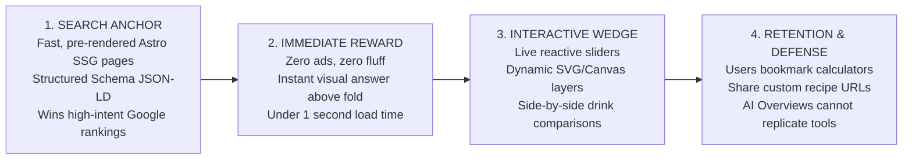

# 16. The Final Strategic Question Answered

**The Core Strategic Question:**  
*Why would someone choose our coffee platform instead of the existing websites already ranking on Google?*

---

## 1. The Definitive Answer: The Zero-Friction "Visual Lab" Advantage

Someone will choose **MyCoffeeLab** because **every existing website ranking on Google forces a painful trade-off that we completely eliminate:**

* If a user visits **WebstaurantStore** or **TasteAtlas**, they get static, non-interactive lists built to sell restaurant supplies or travel guides, with zero ability to adjust recipes or understand extraction science.
* If a user visits **Coffee Affection** or **HomeGrounds**, they are assaulted by 30+ intrusive display ads, video players, and 2,500 words of generic AI-written fluff before getting a single measurement.
* If a user visits **Omni Calculator**, they get a sterile, ugly algebraic formula that treats coffee like a math homework assignment, with zero coffee soul, zero visual feedback, and zero brewing empathy.
* If a user visits **Barista Hustle**, they run directly into dense academic jargon, complex chemistry charts, and expensive course paywalls.
* If a user watches **James Hoffmann** on YouTube, they get brilliant education, but they cannot pause a video at 7:00 AM on their kitchen counter and drag a ratio slider to calculate grams for their specific dripper.

**MyCoffeeLab is the only platform on the internet that unifies:**
1. **Instant, Zero-Friction Utility:** An ad-free, blazingly fast (<1s load time) calculator that uses precision mass (grams) and works seamlessly with wet hands on a mobile phone.
2. **Spatial Visual Comprehension:** Dynamic, interactive 2D/3D glass cross-sections that let users *see* the exact difference between a cortado, flat white, and latte in 2 seconds.
3. **Approachable Coffee Science:** An intuitive "Sour vs Bitter" dial-in troubleshooter that translates elite barista physics into simple, actionable slider adjustments without academic elitism.

---

## 2. The Specific Competitive Advantage We Can Build

Our sustainable competitive advantage is the **"Search Anchor + Interactive Wedge"**:

### Why Google AI Overviews Cannot Destroy This Advantage
Google AI Overviews and LLMs are rapidly destroying traditional informational websites by summarizing static text directly in the search results.  
However, an AI search summary **cannot provide a reactive, drag-and-drop Coffee Lab or an interactive dial-in calculator** inside a search snippet. By embedding interactive utilities at the core of every landing page, our traffic is structurally insulated from zero-click AI erosion.

---

## 3. The Unsolved User Problem We Solve

**The Core Problem:** *Home coffee brewing is plagued by conflicting, confusing, and unrepeatable advice.*
* Beginners are intimidated by Italian names and confused by conflicting drink definitions.
* Casual brewers ruin their coffee because recipe sites tell them to use "tablespoons" instead of weight in grams.
* Home espresso owners waste expensive bags of beans pulling sour, channeled shots because nobody gives them an interactive troubleshooting guide.

**Our Solution:**
* **Clarity:** Standardized, visual, barista-verified drink recipes with exact liquid and foam dimensions.
* **Accuracy:** A non-negotiable **mass-first standard (grams)** that guarantees repeatable results.
* **Troubleshooting:** A tactile diagnostic tool that tells them exactly how to fix a bad cup in real time.

---

## 4. The Experience That Makes the Platform Meaningfully Different

Imagine a user searching Google at 7:15 AM on their phone:  
*"How much coffee for a 500ml Chemex?"*

* **The Competitor Experience (HomeGrounds / Omni):**
  The user taps the link. The screen jumps three times as banner ads load. A sticky video player pops up in the bottom corner. They scroll past "The Rich History of Chemex Brewing" and "Why You Need Good Beans." They finally reach an ad-surrounded form with 6 tiny input boxes. They leave frustrated.
* **The MyCoffeeLab Experience:**
  The user taps the link. The page loads **instantly in 600 milliseconds**. Directly beneath the headline sits a clean, beautiful Chemex carafe visualizer. The slider is already set to 500ml. It clearly displays: **"31.3g Coffee (Golden 1:16 Ratio) • 60g Bloom Water (45s) • Target Brew Time: 3:45"**. Below it is a discreet toggle to adjust strength to Light (1:17) or Strong (1:15).

That 5-second difference in respect for the user's time, craft, and attention is why people will bookmark MyCoffeeLab, share it on Reddit, and make it their permanent morning brewing companion.
